# Лабораторная работа № 1. Установка Debian на виртуальную машину и настройка SSH

ФИО студента: Пархомей Владислав Русланович

## Цель:

Освоить технологию виртуализации на базе Oracle VirtualBox, развернуть гостевую операционную систему Debian, сконфигурировать сетевые интерфейсы в режимах NAT и Bridged Adapter, выполнить актуализацию системных пакетов и обеспечить безопасный удалённый доступ к ВМ посредством протокола SSH с использованием как парольной аутентификации, так и криптографических ключей.

## Используемые средства

| Компонент | Версия |
|---|---|
| Программа-гипервизор | Oracle VirtualBox 7.2.22 |
| Гостевая ОС | Debian 13 «Trixie» (amd64, netinst-образ) |
| Хост-система | Windows 10/11, командная строка (cmd) |

---

## 1. Установка виртуальной машины

### 1.1. Установка VirtualBox

Установщик Oracle VirtualBox загружен с официального сайта [virtualbox.org](https://www.virtualbox.org/wiki/Downloads). Выполнена установка программного обеспечения со стандартными параметрами конфигурации.
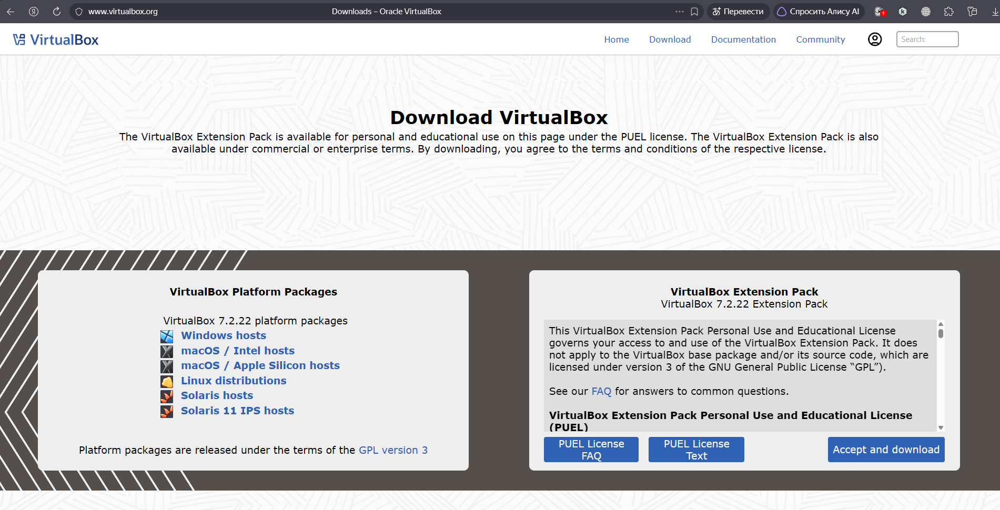
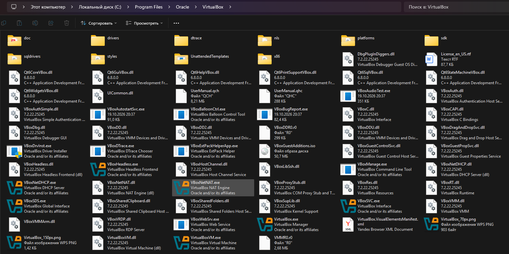

### 1.2. Создание виртуальной машины

Установочный образ `debian-13.7.0-amd64-netinst.iso` загружен с официального сайта проекта [debian.org](https://www.debian.org/):
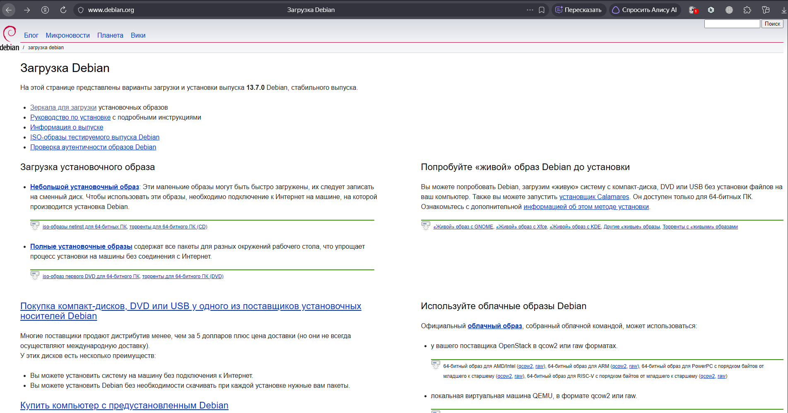

В мастере создания виртуальной машины задано имя `Debian` и указан путь к ISO-образу. Виртуальному оборудованию выделены следующие ресурсы согласно заданию:
- оперативная память: **4096 МБ**;
- процессор: **1 ЦПУ**;
- жёсткий диск: **30 ГБ** (динамически распределяемый, формат VDI).
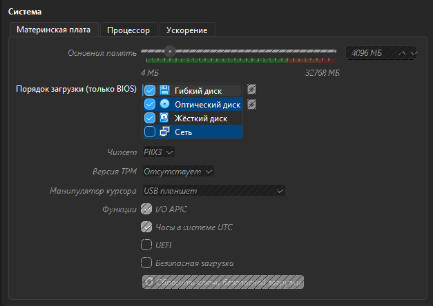
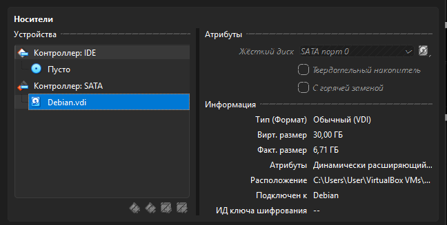

---

## 2. Установка Debian

Установка выполнялась в ручном режиме (без автоматической установки). На этапе выбора программного обеспечения были выбраны только **Standard system utilities** и **SSH server**. Графическая оболочка не устанавливалась изначально для экономии ресурсов.
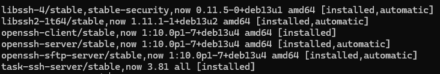

Для получения графического интерфейса после первичной настройки системы был установлен мета-пакет `task-gnome-desktop`, и система переведена в графический режим загрузки:
```bash
sudo apt install task-gnome-desktop -y
sudo systemctl set-default graphical.target
sudo reboot
```

Основные параметры системы:
- Имя компьютера: `debian`;
- Пользователь: `vladislav`;
- Пароль `root`: не задан (доступ через `sudo`).
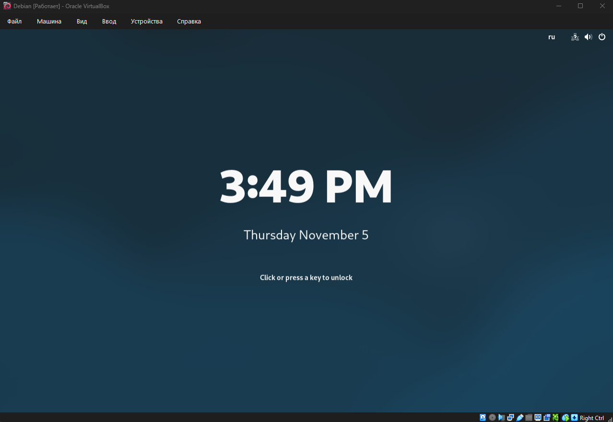

---

## 3. Настройка сети и обновление системы

### 3.1. Режим NAT и Bridge

В процессе работы были протестированы оба режима. При переключении на **Bridged Adapter** виртуальная машина получала IP-адрес от локального роутера, однако из-за особенностей сетевой изоляции хоста (ошибка `Destination Host Unreachable`) было принято решение вернуться к режиму **NAT** как к более стабильному и контролируемому для учебной среды. 
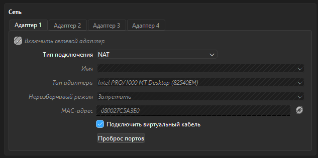

### 3.2. Обновление системы

Выполнены команды обновления списков пакетов и самих пакетов:

```bash
sudo apt update
sudo apt upgrade -y
```
Команды успешно обратились к сетевым репозиториям (`deb.debian.org`, `security.debian.org`). Все пакеты актуализированы.
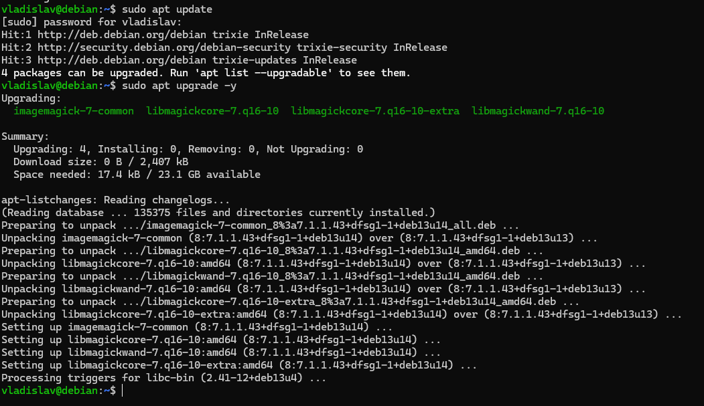

---

## 4. Настройка SSH

### 4.1. Установка и проверка SSH-сервера

Пакет `openssh-server` был установлен на этапе инсталляции ОС. Для верификации статуса выполнена команда `systemctl status ssh`. Согласно выводу, сервис `ssh.service` находится в состоянии `active (running)` и принимает входящие соединения на стандартном порту `22`.
```bash
sudo systemctl status ssh
```
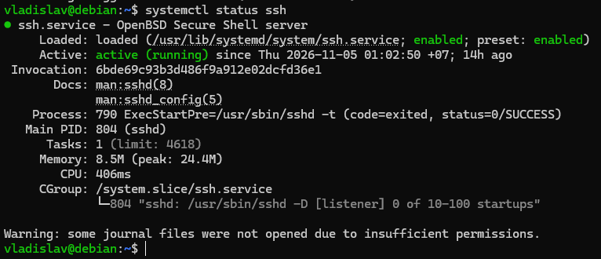

### 4.2. Проброс порта для режима NAT

Так как в режиме NAT виртуальная машина недоступна напрямую по IP из локальной сети, в настройках адаптера VirtualBox («Проброс портов») добавлено правило:

| Имя    | Протокол | Адрес хоста | Порт хоста | Адрес гостя | Порт гостя |
| ------ | -------- | ----------- | ---------- | ----------- | ---------- |
| SSH    | TCP      |             | 2222       |             | 22         |

Теперь подключение к порту `2222` на локальном хосте (`127.0.0.1`) перенаправляется на порт `22` виртуальной машины.
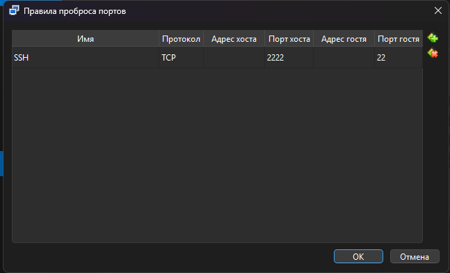

### 4.3. Подключение по паролю

С основного компьютера (Windows) выполнено подключение к виртуальной машине с указанием перенаправленного порта:

```cmd
ssh -p 2222 vladislav@127.0.0.1
```

После подтверждения fingerprint и ввода пароля пользователя `vladislav` вход выполнен успешно.
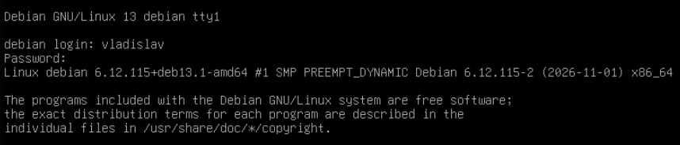

### 4.4. Подключение по ключу

Для входа без пароля использовалась пара ключей SSH (`RSA 4096`), созданная на основном компьютере (хосте) командой:

```cmd
ssh-keygen -t rsa -b 4096
```
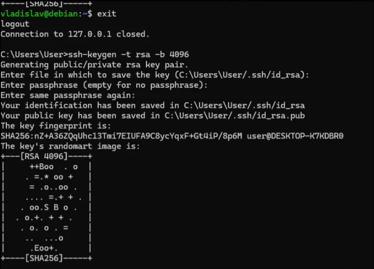

Для настройки беспарольного доступа публичный ключ (`id_rsa.pub`) был скопирован с хост-машины и добавлен в файл `~/.ssh/authorized_keys` гостевой системы вручную через текстовый редактор `nano`.

Последовательность действий на виртуальной машине:
```bash 
mkdir -p ~/.ssh             
nano ~/.ssh/authorized_keys  
chmod 700 ~/.ssh           
chmod 600 ~/.ssh/authorized_keys 
```

После этого повторное подключение выполняется без ввода пароля:
```cmd
ssh -p 2222 vladislav@127.0.0.1
```
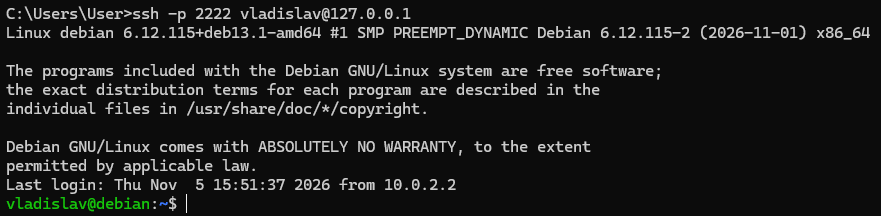

---

## Вывод

В ходе лабораторной работы установлен гипервизор Oracle VirtualBox, создана виртуальная машина с выделением 4 ГБ ОЗУ, 1 ЦПУ и динамического диска объёмом 30 ГБ. На гостевую систему установлена ОС Debian 13 «Trixie» (amd64, netinst) с именем хоста `debian` и пользователем `vladislav`. В ходе работы была вручную установлена графическая оболочка GNOME. Протестированы сетевые режимы NAT и Bridged; для основной работы выбран NAT с настройкой проброса портов (порт хоста 2222 -> порт гостя 22). Выполнено обновление системы (`apt update && apt upgrade`). Установлен и запущен SSH-сервер `openssh-server`. Доступ с хост-машины организован двумя способами: по паролю и по криптографическому ключу RSA (беспарольный вход). Цель работы достигнута: освоены технологии виртуализации, настройки сети Linux и безопасного удалённого администрирования.